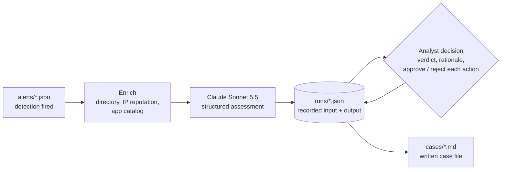

# soc-casebook

AI does first-pass triage on a security alert, a human makes the call, and every alert ends in a written case file.

The model reads the alert and the enrichment and recommends. It never acts. Every containment action waits for a named analyst to approve or reject it, with a reason, and the case file records who decided what and why.

**Start with the override case:** [OAuth consent to a lookalike app](cases/oauth-consent-high-privilege.md). The AI saw an unvetted app with mailbox write access and stopped at "needs more info, low confidence." The analyst compared it against the sanctioned app catalog, found a lookalike of the company's real e-signature vendor asking for permissions the real one never had, and called it an illicit consent grant.

## Try it without an API key

```bash
git clone https://github.com/edwardjgriggs/soc-casebook
cd soc-casebook
pip install -e .
casebook replay --check   # proves every committed case file matches its recorded run
casebook replay           # rebuilds cases/ from runs/, no key, no network
```

Each run in `runs/` holds the exact system prompt, the exact input the model saw, its raw output, and the analyst's decision. Replay re-renders the case files from those records, so the cases can be audited and rebuilt without trusting anything you cannot see.

## How a case is made



1. **Alert.** A case starts at "alert fired": the log rows that matched plus the detection's output row. The three v1 alerts come from the known-bad fixtures of detections in [detection-as-code](https://github.com/edwardjgriggs/detection-as-code), which owns detection correctness.
2. **Enrich.** Offline and deterministic. A directory of the fictional Harborline Federal (role, admin status, MFA methods, usual countries, known IPs), an IP reputation file, and an app catalog. No live lookups, so the same alert always gets the same context.
3. **Assess.** One call to `claude-sonnet-5-5` with the system prompt and output schema in [`prompts/`](prompts/). Structured output means the response either matches the schema or the run fails; there is no free-text parsing.
4. **Decide.** The analyst sets the final verdict and severity, writes the rationale, and approves or rejects every recommended action. The analyst can add actions the AI missed. Decisions can be typed at the prompt or written as a [decision file](decisions/) and reviewed in a diff.
5. **Record and render.** The run is saved to `runs/` and rendered to `cases/`. CI fails if a case file drifts from its run.

## Cases

| Case | Technique | AI | Analyst | Outcome |
|---|---|---|---|---|
| [MFA fatigue burst](cases/mfa-fatigue-burst.md) | T1621 | True positive (high) | True positive | Agree; analyst rejects the IP block |
| [Brute force then success](cases/brute-force-then-success.md) | T1110.001 | True positive (high) | True positive | Agree; analyst adds an account disable |
| [OAuth consent, high privilege](cases/oauth-consent-high-privilege.md) | T1528 | Needs more info (low) | True positive | **Override** |

Every case file has the same eight sections: verdict and summary, timeline, evidence, AI assessment (verbatim), human decision and rationale, actions with approver and reason, ATT&CK mapping, and detection tuning notes.

## Running triage yourself

```bash
pip install -e ".[dev]"
export ANTHROPIC_API_KEY=...                     # only read from the environment
casebook triage alerts/mfa-fatigue-burst.json --force
casebook decide mfa-fatigue-burst                # re-decide a recorded run, no new model call
pytest
```

`triage` saves the AI output before asking for a decision, so walking away mid-review loses nothing: the case renders as "awaiting human decision" with no action approved.

## Layout

| Path | What it holds |
|---|---|
| `alerts/` | One alert per case: the log rows that fired plus the detection's output |
| `context/` | Harborline Federal directory, IP reputation, and app catalog |
| `prompts/` | System prompt and the output schema the model must match |
| `runs/` | Recorded runs: model input, raw output, and the human decision |
| `decisions/` | Analyst decision files applied with `--decisions` |
| `cases/` | Rendered case files. Generated; do not edit by hand |
| `src/casebook/` | The CLI: enrich, assess, approve, render, replay |
| `tests/` | pytest. Tests use a stand-in client and never call the API |

## Ground rules

- All people, domains, and IPs are fictional. The org domain is `harborline.example`, and every IP comes from the RFC 5737 documentation ranges; the alert schema rejects anything else.
- The API key comes only from `ANTHROPIC_API_KEY`. gitleaks runs in CI.
- The lab that produces real telemetry lives in [soc-detection-lab](https://github.com/edwardjgriggs/soc-detection-lab).

## License

[MIT](LICENSE)
